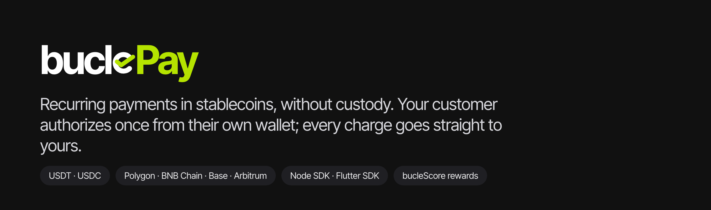
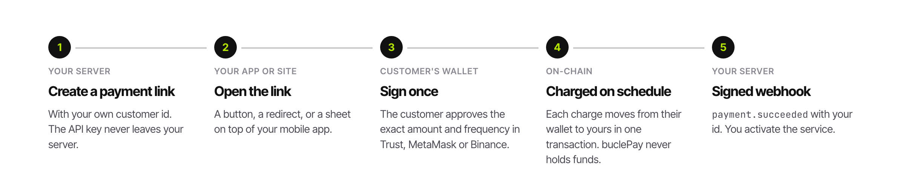
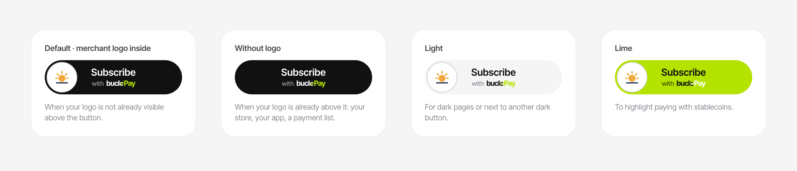
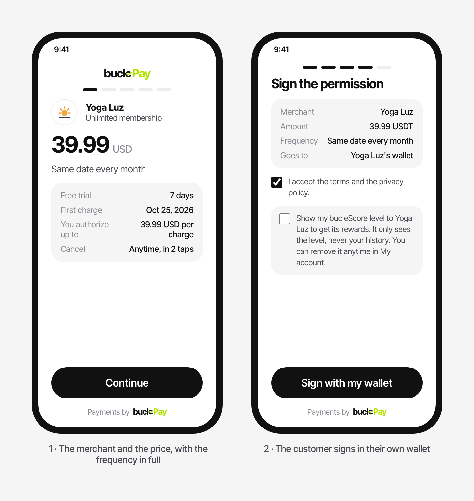
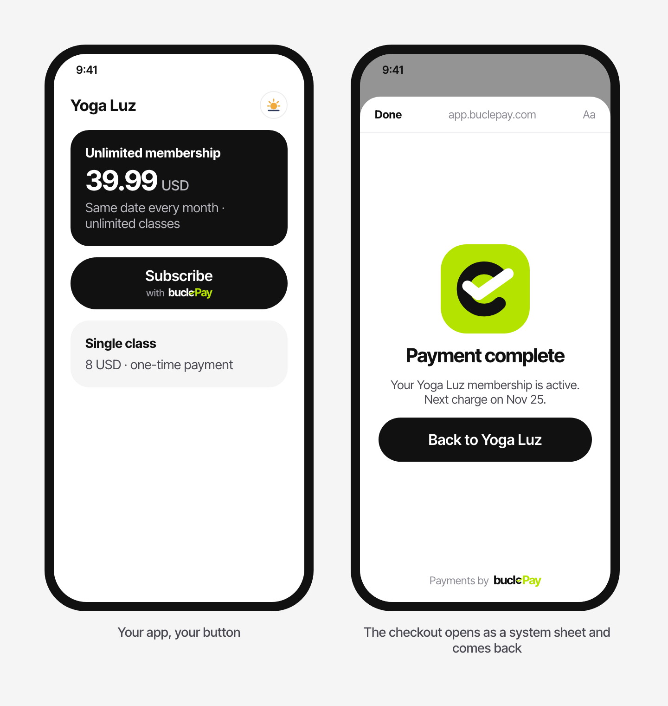
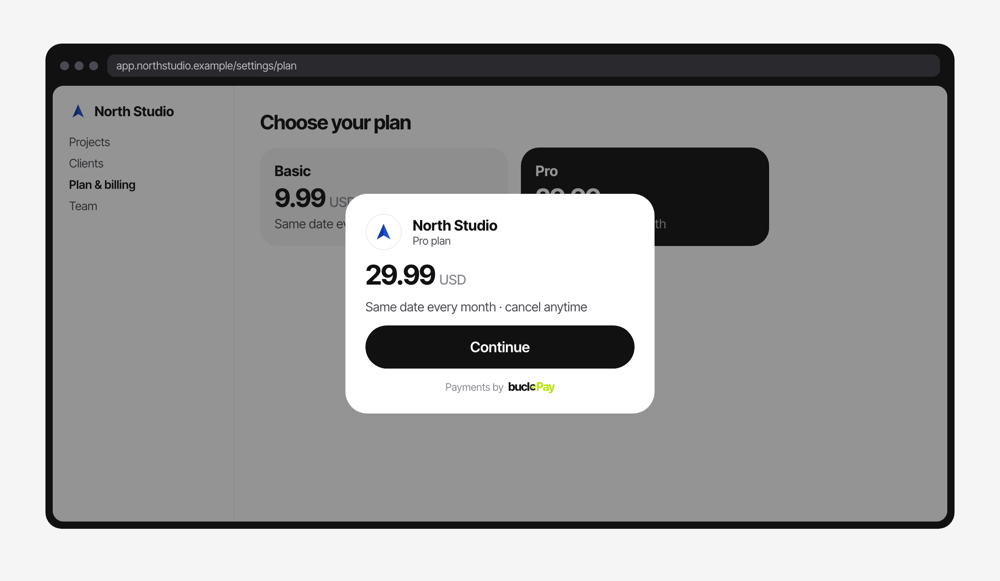
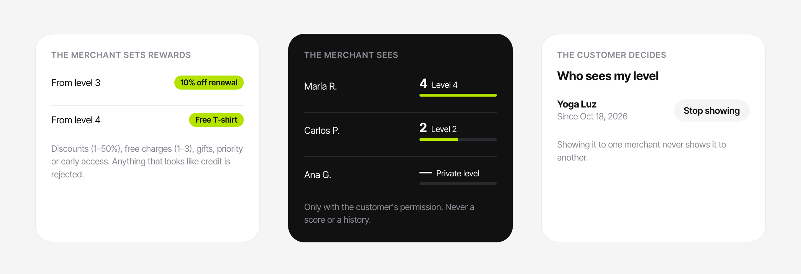

# buclePay

**Recurring payments in stablecoins, without custody.** Your customer authorizes once from their own wallet; every charge goes from their wallet to yours in a single on-chain transaction. buclePay never holds the money.

[Integration guide](docs/INTEGRATION.md) · [For AI coding agents](AGENTS.md) · [Security](SECURITY.md)

## How it works



1. **Your server** creates a payment link with your own customer id.
2. **Your app or site** opens it: a button, a redirect or a sheet on top of your mobile app.
3. **The customer** signs once in their wallet (Trust, MetaMask, Binance…): the exact amount, frequency and limit.
4. **On schedule**, each charge moves from their wallet to yours. Fees are split in the same transaction.
5. **Your server** receives a signed webhook and grants the service.

Subscriptions, installments that end by themselves, free trials, one-time payments and invoices. USDT and USDC on Polygon, BNB Chain, Arbitrum and Base.

## Quick start (Node)

```bash
npm i @buclepay/node
```

```js
import { BuclePay } from '@buclepay/node';
const bp = new BuclePay(process.env.BUCLEPAY_API_KEY); // server only

// 1. create the link when the customer taps "pay"
const { data: link } = await bp.paymentLinks.create({
  amount_usd: 9.99, interval: 'month', description: 'Pro plan',
  client_reference_id: 'user_123', success_url: 'https://example.com/billing?done=1',
});
// → open link.url

// 2. receive the signed webhook (raw body)
const event = bp.webhooks.constructEvent(rawBody, req.headers['buclepay-signature'], process.env.BUCLEPAY_WHSEC);
if (event.type === 'payment.succeeded') grantAccess(event.data.object.subscription.client_reference_id);
```

Ready-to-copy projects: [Node + Express](examples/node-express) · [Next.js](examples/nextjs) · [Flutter](sdk/flutter/example).

## What your customer sees

**The button** carries your words ("Subscribe") and the "with buclePay" mark. Your logo goes inside only when it is not already visible above it.



On a website, the ready-made button is two lines: [`<buclepay-button>`](sdk/web/README.md).

**The checkout** shows your name and logo first, the price with its frequency in full, and what the customer is authorizing.



**In a mobile app** the checkout opens as a system sheet on top of your app and comes back to it. The customer never leaves.



**In a web app** it opens on top of your billing page.



## bucleScore: reward on-time customers



Every payer builds a bucleScore with their payments. Merchants **never** see the score or the history: only the **level (1–4)**, only if the customer chose to show it, and only to give **rewards** (discounts, free charges, gifts, priority, early access). Using it to deny service, ask for deposits or offer credit is not allowed.

```js
await bp.perks.create({ min_level: 3, kind: 'discount_pct', value: 10, title: '10% off your renewal' });
const { data } = await bp.customers.perks('cus_…'); // { level_shared, level, perks }
```

## Platforms (coming soon)

Coming soon: if your software installs buclePay for many merchants, you will be able to earn your own commission on each charge, up to 5% (a cap written in the contract). Each merchant signs it from their own wallet; you can lower it anytime, and raising it needs a new signature from the merchant. Contact hello@buclepay.com to join the waitlist.

## What is in this repository

| Folder | What | License |
|---|---|---|
| [`sdk/node`](sdk/node) | Node.js SDK `@buclepay/node`: links, subscriptions, events, webhooks, bucleScore rewards. No dependencies | MIT |
| [`sdk/web`](sdk/web) | `<buclepay-button>`: the payment button for any website, two lines, no dependencies | MIT |
| [`sdk/flutter`](sdk/flutter) | `buclepay_checkout`: the checkout as a system sheet, with deep-link return | MIT |
| [`examples`](examples) | Node + Express and Next.js, tested | MIT |
| `contracts` | `BuclePayMandates`, the on-chain contract: published here after its external audit | BUSL-1.1 |
| [`docs`](docs) | Integration guide | MIT |
| [`AGENTS.md`](AGENTS.md), [`llms.txt`](llms.txt) | Rules and recipe for AI coding agents | MIT |

## Using it with an AI coding assistant

Point Claude, Codex or Cursor to [AGENTS.md](AGENTS.md). It lists the rules an integration must never break (keys only on the server, access only from verified webhooks, raw-body signature check, system sheet on mobile) and the exact steps, with templates in [`examples`](examples).

## Security

- Non-custodial by design: the contract never holds a balance, and no role at buclePay can redirect a merchant's money or charge outside a signed mandate. Its source is published here after its external audit.
- Report vulnerabilities privately: see [SECURITY.md](SECURITY.md).

## Trademark

"buclePay" and its logo are trademarks of buclePay. The licenses in this repository do not grant rights to use them: forks must use a different name and logo.
